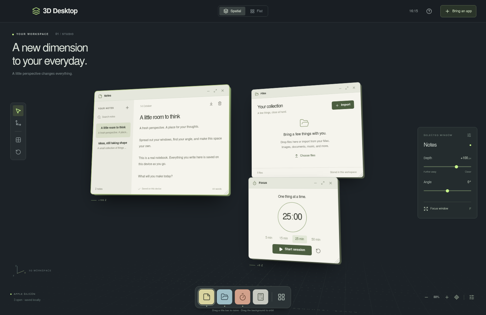

# 3D Desktop

A local 3D desktop companion for Apple Silicon Macs, including M3. Place windows in depth, orbit your workspace, and focus one window when you want to work.



3D Desktop includes working Notes, Files, Focus Timer, and Calculator apps. It can also show live views of other Mac apps or your desktop, and launch apps from your Applications folders.

**Live Mac windows are view-only.** Use **Open original** to interact with the original app. 3D Desktop is a separate spatial workspace, not a replacement for the macOS window manager. It does not forward your keystrokes or clicks into other apps.

## Install on your Mac

1. Download [3D-Desktop-1.0.0-mac-arm64.zip](https://github.com/Ninnja10563/3D-Desktop/releases/download/v1.0.0/3D-Desktop-1.0.0-mac-arm64.zip) and extract the entire ZIP.
2. Keep `3D Desktop.app` and `Install 3D Desktop.command` together. Control-click **Install 3D Desktop.command**, choose **Open**, and read the prompt.
3. Type `y` to install into `~/Applications`. The installer opens 3D Desktop when it finishes. No administrator access is required.

This build is **not Apple Developer ID signed or notarized**. The installer copies the app, signs that copy locally on your Mac, and removes the quarantine flag only from that copy. It does not disable Gatekeeper. It backs up an existing 3D Desktop app instead of deleting it. The installer is a readable shell script; you can open it in a text editor before running it.

If macOS blocks the command file, open Terminal, type `bash` followed by a space, drag `Install 3D Desktop.command` into Terminal, and press Return.

Requires an Apple Silicon Mac running macOS 13 Ventura or later, as declared by the packaged runtime. The package is built for `darwin-arm64`, with no Rosetta requirement.

## Bring in your Mac apps

Choose **Bring an app**, then pick a window or display. On first use, enable 3D Desktop in **System Settings → Privacy & Security → Screen & System Audio Recording**, then quit and reopen 3D Desktop. The wording of the preference may vary with your macOS version. The picker includes a button to open the relevant settings.

Live views stay on your device, have no audio, and are never uploaded or recorded. Closing a live window or quitting 3D Desktop stops capture. Minimizing a live view keeps sharing active, and its dock icon restores it. Up to six live views can be open at once. They must be shared again after restarting.

Use **Link to Mac app…** if 3D Desktop cannot identify the app automatically, then **Open original** to switch to it. The app launcher also opens installed Mac apps. Protected video and some minimized apps may not produce useful frames; bring the original window onscreen if a view is blank or frozen.

## Controls

| Action | Control |
| --- | --- |
| Move a window | Drag its title bar |
| Resize a window | Drag its bottom-right corner |
| Adjust depth or angle | Select the window, then use the right-hand sliders |
| Orbit the scene | Drag empty space |
| Zoom | Scroll on empty space or use the bottom-right buttons |
| Focus a window | Its expand button, the inspector's **Focus window**, or `F` |
| Return from focus | `Escape` or **Back to space** |
| Restore a minimized window | Click its dock icon |
| Open the app launcher | `⌘K` |
| Open Notes | `N` |
| Reset the camera | `R` |
| Change selected window depth | `Option` + `↑` / `↓` |
| Arrange all windows | **Tile windows** in the left toolbar |
| Recover the initial layout | **Reset workspace**; notes and files remain intact |
| Show help | `?` or the help button |

Spatial and Flat views share window positions. Focus mode brings the selected window forward with a straight-on view. Keyboard shortcuts do not trigger while you are typing in an input.

## Your data

- **Notes:** multiple notes, search, local autosave, confirmed deletion, and text export.
- **Files:** explicitly import or drop files, preview images/text/audio/video, download originals, and confirm removal. Imports are copies in this workspace; originals on disk are untouched. Maximum size is 100 MB per imported file.
- **Focus:** 5, 15, 25, or 50 minute sessions. The timer uses a real deadline and resumes accurately after reopening; pausing preserves the remaining time.
- **Calculator:** keyboard or button input, parentheses, arithmetic precedence, and clear error messages. Expressions are parsed without `eval`.
- **Workspace:** saved positions, size, depth, angle, minimized state, camera, and room palette.

The Mac app stores browser data in its local Electron profile, at `~/Library/Application Support/Depth` (the original profile name is retained so existing notes, files, and layouts continue to work). Browser-preview data stays in that browser's profile and does not transfer automatically to the Mac app. Removing the profile or clearing site data removes that copy of your notes and imported files. Export anything you want to keep independently.

## Run from source

Use Node.js 24 or later and npm.

```sh
npm ci
npm run desktop
```

For the browser preview:

```sh
npm run dev
```

Open the printed local URL. The four built-in apps and spatial controls work in the browser. Screen sharing requires a compatible browser and localhost or HTTPS; the installed-app launcher is available in the native Mac app.

To create the Apple Silicon package:

```sh
npm run package:mac
```

The packaging step stages only compiled frontend files, the native shell, and metadata, then produces the app and ZIP under `release/`. macOS packaging uses local ad-hoc signing. Linux can cross-package the arm64 Mac app; the included installer signs the installed copy on the destination Mac. A Developer ID release would require an Apple signing identity and notarization credentials.

## Verification

```sh
npm test
npm run build
npx playwright install chromium
npm run test:e2e
```

Tests cover workspace validation and geometry, calculator parsing, native IPC and permission boundaries, notes and file persistence, timer behavior, window interactions, and capture cleanup. Browser capture tests use a real generated `MediaStream` with a mocked picker; they do not validate macOS Screen Recording permissions.

The build environment is Linux ARM64. The browser UI, production compilation, native security logic, and Mac archive structure can be verified here. **The macOS binary, system permission dialog, and installed-app switching have not been run on Mac hardware.**

Built with React, TypeScript, CSS 3D transforms, and Electron. Native capture follows [Electron's desktop capture API](https://www.electronjs.org/docs/latest/api/desktop-capturer) and [session permission APIs](https://www.electronjs.org/docs/latest/api/session). Mac packaging uses [Electron Packager](https://electron.github.io/packager/main/interfaces/Options.html).

MIT licensed; see [LICENSE](LICENSE).
